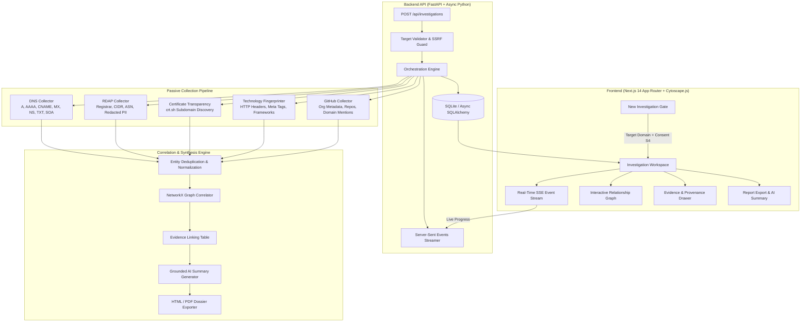
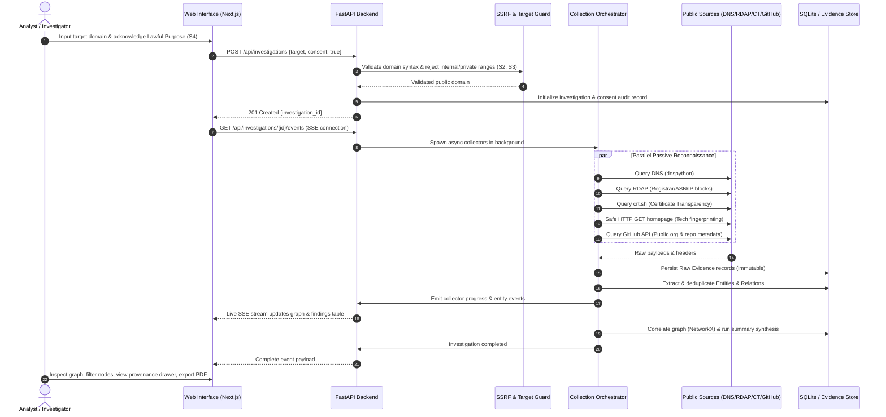
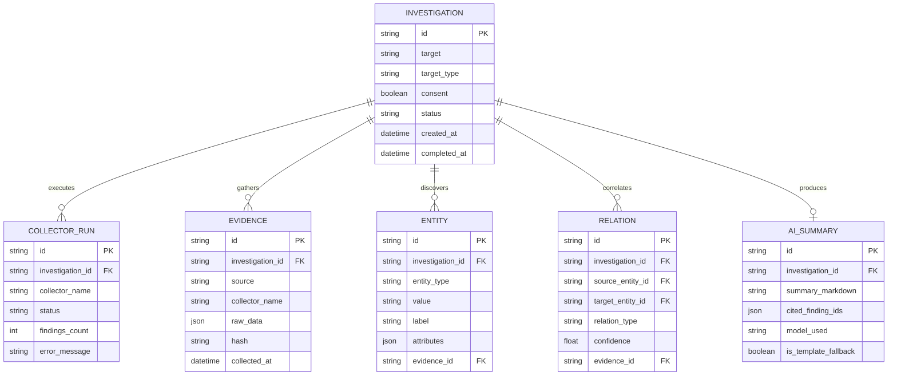

# RedString (OSINT Investigation Copilot)

[](https://www.python.org/downloads/)
[](https://fastapi.tiangolo.com/)
[](https://nextjs.org/)
[](https://www.typescriptlang.org/)
[](https://opensource.org/licenses/MIT)

**RedString** is an operational, evidence-grounded OSINT (Open Source Intelligence) investigation copilot. It allows security analysts and researchers to supply a target domain or company, conduct passive reconnaissance across public telemetry sources, link correlated entities into an interactive relationship graph, enforce cryptographic provenance over every piece of evidence, and generate audit-ready intelligence reports with grounded AI synthesis.

---

## ⚡ Quick Start (Under 10 Commands)

### 1. Backend Setup
```bash
cd backend
python -m venv .venv

# Windows (PowerShell / Command Prompt):
.venv\Scripts\activate

# Linux / macOS:
source .venv/bin/activate

pip install -r requirements.txt
cp .env.example .env
python -m uvicorn app.main:app --reload --port 8000
```

### 2. Frontend Setup
```bash
cd frontend
npm install
npm run dev
```

Navigate to **[http://localhost:3000](http://localhost:3000)** in your browser (or **[http://localhost:3000/_ui](http://localhost:3000/_ui)** for the Design System catalog).

---

## 🧭 Key Features & Navigation

- **New Investigation (`/`)**: Domain target entry guarded by the lawful-purpose Consent Gate (Rule S4).
- **History (`/investigations`)**: Audit trail of previous investigations with search, filter, and permanent deletion (GDPR/privacy control). Includes a **"Load Demo Data"** action for instant offline presentations.
- **Investigation Workspace (`/investigations/[id]`)**:
  - **Overview**: High-level entity metric counters, execution milestones, and limitations.
  - **Interactive Graph**: Cytoscape.js canvas with Okabe-Ito colour-blind safe palette, distinct geometric shapes per entity type, Force/Concentric layouts, PNG export, and an integrated **Accessible Table Alternative** (WCAG 2.2 AA).
  - **Findings & Category Tabs**: DNS, RDAP, Certificates, Technologies, Repositories tables with search and sorting.
  - **Evidence Panel**: Persistent 320px inspector displaying immutable raw proofs, timestamps, and collector versions for any selected node or row.
  - **AI Summary**: Grounded summary engine with model/prompt version badges, markdown copy, regeneration, and clickable `[F-XXXXXX]` finding chips linking directly to raw evidence.
  - **Export Report**: Print-ready 13-section report (`/report`).
- **Settings & Diagnostics (`/settings`)**: Read-only inspection of active API integrations, rate-limit warnings, and security perimeter rules without leaking secrets.
- **Legal Documentation (`/legal/*`)**: Policies for Acceptable Use, Privacy, and Terms of Service.

---

## 🏗️ System Architecture



---

## 🔄 Investigation Lifecycle



---

## 🗄️ Data Model & Evidence Linking



---

## 🛡️ Safety & Non-Negotiable Rules

| Identifier | Constraint | Implementation Control |
|---|---|---|
| **S1** | **Passive only** | Allowed: DNS queries, public RDAP/Whois, Certificate Transparency (`crt.sh`), public GitHub metadata, single GET of homepage. No port scans, brute-forcing, or exploits. |
| **S2** | **SSRF Guard** | Pre-flight DNS resolution before HTTP dispatch. Loops, private IP ranges (RFC 1918), link-local (`169.254.0.0/16`), IPv6 loopbacks, and non-HTTP ports (strictly 80/443) are blocked. Re-validates every redirect hop (max 3). Max payload 2 MB. |
| **S3** | **Target validation** | Strict regex and public suffix validation (`tldextract`). Rejects IP addresses, localhost, RFC 2606 test domains, and URLs containing paths or embedded credentials. |
| **S4** | **Consent gate** | API rejects requests without `consent=true` confirming lawful purpose. Stored alongside investigation audit timestamp. |
| **S5** | **No secrets hunting** | GitHub collector strictly queries public repository metadata and README domain mentions. Does not crawl commits, keys, or private files. |
| **S6** | **No personal profiling** | Drops personal registrant information from RDAP responses. Displays only "redacted / withheld" to prevent PII harvesting. |
| **S7** | **Respect limits** | Honors `robots.txt` directives for web requests, respects rate-limit headers, and enforces 24-hour response caching (`http_cache`). |
| **S8** | **Secrets safety** | All credentials loaded via `.env`; never committed or logged in production. |
| **S9** | **Prompt Injection Isolation** | Collected untrusted web text (HTML/headers/READMEs) is strictly sandboxed in delimited data blocks. Summaries citation-checked against database entity IDs with 100% offline deterministic fallback. |
| **S10** | **No fabricated data** | Sample and synthetic data explicitly labelled `[Demo Data]`. |
| **S11** | **Honest claims** | Findings classified as "observed" or "inferred", never "proven". |

---

## 💻 Tech Stack

### Backend
- **Framework:** FastAPI with Uvicorn (ASGI)
- **Language & Runtime:** Python 3.11+ / 3.13 (Async I/O)
- **Data & ORM:** SQLite with Async SQLAlchemy 2.x (`aiosqlite`) & Alembic migrations
- **Network & DNS:** `httpx` (async client with custom SSRF safe-transport) & `dnspython`
- **Parsing & Graphing:** `BeautifulSoup4` + `lxml`, `NetworkX` (graph correlation)
- **Testing & Code Quality:** `pytest`, `pytest-asyncio`, `respx`, `ruff`, `mypy`

### Frontend
- **Framework:** Next.js 14 (App Router) with React 18 & TypeScript (strict)
- **Styling & Tokens:** Tailwind CSS with CSS Variables Design System (`tokens.css`, 4px/6px radii, Okabe-Ito color-blind palette)
- **State & Data Fetching:** TanStack React Query v5 (SSE streaming & cached polling)
- **Graph Visualization:** Cytoscape.js with layout adaptors
- **Icons & UI Primitives:** Lucide React, Radix UI primitives (`dialog`, `popover`, `tabs`, `tooltip`)

---

## 📁 Project Structure

```text
RedString/
├── backend/
│   ├── app/
│   │   ├── ai/               # Grounded AI summarizer & template fallback
│   │   ├── api/              # FastAPI routes (investigations, health, system, SSE)
│   │   ├── collectors/       # Passive collectors (DNS, RDAP, CT, Tech, GitHub)
│   │   ├── core/             # SSRF guard, safe HTTP client, orchestrator
│   │   ├── correlation/      # Entity linking & NetworkX graph engine
│   │   ├── models/           # SQLAlchemy ORM models & Pydantic schemas
│   │   ├── reporting/        # HTML & PDF export generators
│   │   ├── config.py         # App settings & environment validation
│   │   ├── db.py             # Database engine & session setup
│   │   └── main.py           # FastAPI application entrypoint
│   ├── tests/                # Unit, integration, and safety tests
│   ├── requirements.txt      # Production dependencies
│   └── requirements-dev.txt  # Testing, linting, and typing dependencies
├── frontend/
│   ├── app/
│   │   ├── investigations/   # Dynamic workspace & report view routes
│   │   ├── legal/            # Acceptable Use, Privacy, and Terms pages
│   │   ├── settings/         # Diagnostics & API key configuration preview
│   │   ├── _ui/              # Design system kitchen sink preview
│   │   ├── layout.tsx        # Shell layout & provider wrappers
│   │   ├── page.tsx          # New Investigation entry & recent scans
│   │   └── tokens.css        # Core design tokens (radii, palettes, surfaces)
│   ├── components/           # UI components (GraphView, EvidencePanel, SummaryCard)
│   ├── lib/                  # API client (lib/api.ts), styles, and export utilities
│   ├── package.json
│   └── tailwind.config.ts
├── docs/                     # Specifications, architecture decisions (ADR), evaluation
├── AGENTS.md                 # Working rules & engineering guidelines
├── PROJECT_SPEC.md           # Master technical specification
├── UI_SPEC.md                # UI design system & interaction specification
└── README.md
```

---

## 🧪 Verification & Testing

RedString enforces rigorous test suites across safety constraints, collectors, and user interfaces:

### Backend Testing & Type Checking
```bash
# Run unit & safety test suites (87+ tests)
cd backend
python -m pytest tests -v

# Run code style & linting checks
ruff check app

# Run static type verification
mypy app
```

### Frontend Testing & Type Checking
```bash
cd frontend

# Verify TypeScript strict typing
npm run type-check

# Run frontend tests
npm test

# Run ESLint
npm run lint

# Production build validation
npm run build
```

---

## 📄 License

This project is licensed under the [MIT License](LICENSE).
